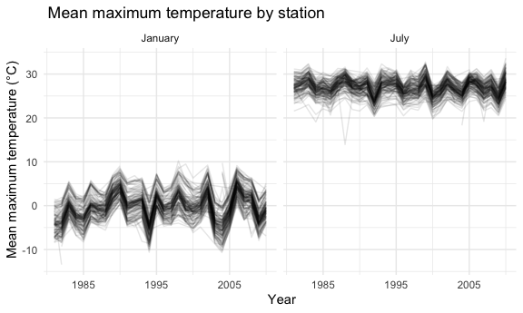
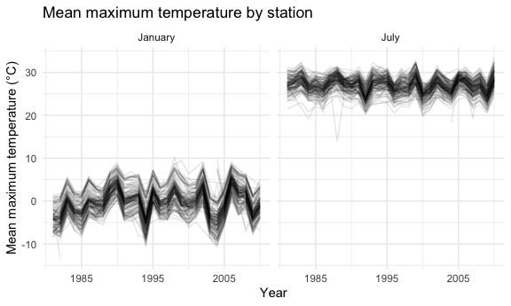
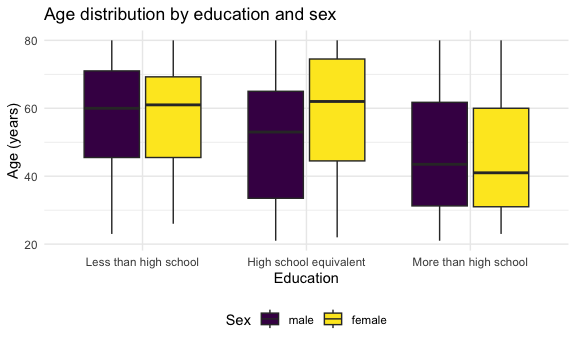
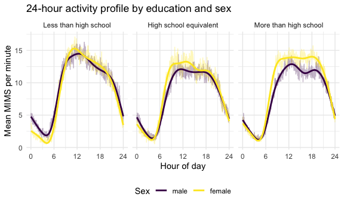

p8105_hw3_hyw2105
================
2026-10-14

``` r
library(tidyverse)
```

    ## ── Attaching core tidyverse packages ──────────────────────── tidyverse 2.0.0 ──
    ## ✔ dplyr     1.2.1     ✔ readr     2.2.0
    ## ✔ forcats   1.0.1     ✔ stringr   1.6.0
    ## ✔ ggplot2   4.0.3     ✔ tibble    3.3.1
    ## ✔ lubridate 1.9.5     ✔ tidyr     1.3.2
    ## ✔ purrr     1.2.2     
    ## ── Conflicts ────────────────────────────────────────── tidyverse_conflicts() ──
    ## ✖ dplyr::filter() masks stats::filter()
    ## ✖ dplyr::lag()    masks stats::lag()
    ## ℹ Use the conflicted package (<http://conflicted.r-lib.org/>) to force all conflicts to become errors

``` r
library(p8105.datasets)
library(patchwork)
library(ggridges)

knitr::opts_chunk$set(fig.width = 6, fig.asp = .6, out.width = "90%")
theme_set(theme_minimal() + theme(legend.position = "bottom"))
options(ggplot2.continuous.colour = "viridis", ggplot2.continuous.fill = "viridis")
scale_colour_discrete = scale_colour_viridis_d
scale_fill_discrete = scale_fill_viridis_d
```

## Problem 1

``` r
ny_noaa_clean =
ny_noaa |>
mutate(
year = lubridate::year(date),
month= lubridate::month(date),
day = lubridate::day(date),
tmax = as.numeric(tmax) / 10,
tmin = as.numeric(tmin) / 10,
prcp=prcp / 10
)

ny_noaa_clean |>
  summarize(
    across(c(prcp, snow, snwd, tmax, tmin), ~ mean(is.na(.x)) * 100)
  ) |>
  knitr::kable(digits = 1)
```

| prcp | snow | snwd | tmax | tmin |
|-----:|-----:|-----:|-----:|-----:|
|  5.6 | 14.7 | 22.8 | 43.7 | 43.7 |

``` r
ny_noaa_clean |>
  count(snow, sort = TRUE) |>
  head(10)
```

    ## # A tibble: 10 × 2
    ##     snow       n
    ##    <int>   <int>
    ##  1     0 2008508
    ##  2    NA  381221
    ##  3    25   31022
    ##  4    13   23095
    ##  5    51   18274
    ##  6    76   10173
    ##  7     8    9962
    ##  8     5    9748
    ##  9    38    9197
    ## 10     3    8790

The most common snowfall value is 0 mm (2,008,508 observations),
accounting for about 77% of all observations. This is probably because
it does not snow on most days in New York.

The second most common value is NA (381,221 observations), which means
no measurement was recorded on those days. This is not the same as a day
with no snowfall.

Among the non-zero values, the most frequent are 25, 13, 51 and 76 mm,
which correspond closely to 1, 0.5, 2 and 3 inches (1 inch = 25.4 mm).
This suggests that snowfall was originally recorded in inches and then
converted to millimeters, so values near whole or half inches appear far
more often than others.

## January and July mean maximum temperature

``` r
monthly_tmax_df =
ny_noaa_clean |>
filter(month %in% c(1,7)) |>
group_by(id, year, month)|>
summarize(mean_tmax = mean(tmax, na.rm = TRUE), .groups = "drop")
head(ny_noaa_clean)
```

    ## # A tibble: 6 × 10
    ##   id          date        prcp  snow  snwd  tmax  tmin  year month   day
    ##   <chr>       <date>     <dbl> <int> <int> <dbl> <dbl> <dbl> <dbl> <int>
    ## 1 US1NYAB0001 2007-11-01    NA    NA    NA    NA    NA  2007    11     1
    ## 2 US1NYAB0001 2007-11-02    NA    NA    NA    NA    NA  2007    11     2
    ## 3 US1NYAB0001 2007-11-03    NA    NA    NA    NA    NA  2007    11     3
    ## 4 US1NYAB0001 2007-11-04    NA    NA    NA    NA    NA  2007    11     4
    ## 5 US1NYAB0001 2007-11-05    NA    NA    NA    NA    NA  2007    11     5
    ## 6 US1NYAB0001 2007-11-06    NA    NA    NA    NA    NA  2007    11     6

``` r
monthly_tmax_df |> summarize(n_nan = sum(is.nan(mean_tmax)), n_total = n())
```

    ## # A tibble: 1 × 2
    ##   n_nan n_total
    ##   <int>   <int>
    ## 1  5970   14111

## January and July mean maximum temperature

``` r
monthly_tmax_df |>
 drop_na(mean_tmax) |> 
mutate(month = factor(month, levels = c(1, 7), labels = c("January", "July")))|> 
  ggplot(aes(x = year, y = mean_tmax, group = id)) +
  scale_x_continuous(breaks = c(1985, 1995, 2005))+
  geom_line(alpha = .1) +
  facet_grid(. ~ month) +
  labs(
    title = " Mean maximum temperature by station", 
    x = " Year", 
    y = " Mean maximum temperature (°C)"
    )
```



``` r
monthly_tmax_df |>
  drop_na(mean_tmax) |>
  filter(month == 7, mean_tmax < 17)
```

    ## # A tibble: 1 × 4
    ##   id           year month mean_tmax
    ##   <chr>       <dbl> <dbl>     <dbl>
    ## 1 USC00308962  1988     7      14.0

``` r
ny_noaa_clean |>
  filter(id == "USC00308962", year == 1988, month == 7) |>
  summarize(n_days = n(), n_valid_tmax = sum(!is.na(tmax)))
```

    ## # A tibble: 1 × 2
    ##   n_days n_valid_tmax
    ##    <int>        <int>
    ## 1     31           31

The plot shows the mean maximum temperature for each station in January
and July from 1981 to 2010. In January, most station means range from
about -10 to 8 °C, while in July they are higher, ranging from about 21
to 32 °C. The lines move up and down together across stations, which
suggests that year-to-year changes are driven mainly by regional weather
shared across stations rather than by local conditions at individual
stations. This year-to-year variation is larger in January. There are a
few outliers; for example, station USC00308962 in July 1988 has a mean
of about 14 °C, far below other stations that year. Because this station
has valid data on all 31 days, the low value is unlikely to result from
missing data; it may reflect a local measurement or recording problem,
although this cannot be confirmed from these data alone.

## Temperature and snowfall plots

``` r
hex_plot =
  ny_noaa_clean |>
  ggplot(aes(x = tmin, y = tmax)) +
  geom_hex() +
  scale_fill_continuous(breaks = c(10000, 30000, 50000)) +
  theme(legend.key.width = unit(1.5, "cm")) +
  labs(
    title = "Maximum vs minimum temperature",
    x = "Minimum temperature (°C)",
    y = "Maximum temperature (°C)",
    fill = "Count"
  )

ridge_plot =
  ny_noaa_clean |>
  filter(snow > 0, snow < 100) |>
  mutate(year = factor(year)) |>
  ggplot(aes(x = snow, y = year)) +
  geom_density_ridges() +
  scale_y_discrete(breaks = as.character(seq(1985, 2010, by = 5))) +
  labs(
    title = "Snowfall distribution by year",
    x = "Snowfall (mm)",
    y = "Year"
  )

hex_plot + ridge_plot
```

    ## Warning: Removed 1136276 rows containing non-finite outside the scale range
    ## (`stat_binhex()`).

    ## Picking joint bandwidth of 3.76


The left panel shows the relationship between daily minimum and maximum
temperature for all observations. A hex plot is used because there are
more than two million rows, and a scatterplot would be heavily
overplotted. The two variables are positively associated: most
observations fall in a narrow diagonal band, and the densest hexagons
(more than 40,000 observations each) are around a minimum of 10–15 °C
and a maximum of 20–25 °C. A few isolated hexagons are implausible,
including maximum temperatures above 50 °C (some near 60 °C) and several
points where the minimum temperature is higher than the maximum, such as
a minimum near 50 °C with a maximum near 0 °C. These are likely
recording errors.

The right panel shows the distribution of snowfall values between 0 and
100 mm for each year. The distributions are similar across years: each
has a large mass of small values (below about 15 mm), followed by
smaller peaks near 25, 51 and 76 mm, which is consistent with snowfall
being recorded in inches and then converted to millimeters. Differences
between years are small; for example, 2010 appears to have a taller peak
at the low end than most other years.

``` r
ny_noaa_clean |>
  filter(tmin > tmax) |>
  count()
```

    ## # A tibble: 1 × 1
    ##       n
    ##   <int>
    ## 1  1183

1183 observations have a minimum temperature higher than the maximum.

\##Problem 2

``` r
covar_df =
  read_csv("data/nhanes_covar.csv", skip = 4, na = c("", ".", "NA")) |>
  janitor::clean_names()
```

    ## Rows: 250 Columns: 5
    ## ── Column specification ────────────────────────────────────────────────────────
    ## Delimiter: ","
    ## dbl (5): SEQN, sex, age, BMI, education
    ## 
    ## ℹ Use `spec()` to retrieve the full column specification for this data.
    ## ℹ Specify the column types or set `show_col_types = FALSE` to quiet this message.

``` r
accel_df =
  read_csv("data/nhanes_accel.csv") |>
  janitor::clean_names()
```

    ## Rows: 250 Columns: 1441
    ## ── Column specification ────────────────────────────────────────────────────────
    ## Delimiter: ","
    ## dbl (1441): SEQN, min1, min2, min3, min4, min5, min6, min7, min8, min9, min1...
    ## 
    ## ℹ Use `spec()` to retrieve the full column specification for this data.
    ## ℹ Specify the column types or set `show_col_types = FALSE` to quiet this message.

``` r
nhanes_df =
  left_join(covar_df, accel_df, by = "seqn") |>
  drop_na(sex, age, bmi, education) |>
  filter(age >= 21) |>
  mutate(
    sex = factor(sex, levels = c(1, 2), labels = c("male", "female")),
    education = factor(
      education,
      levels = c(1, 2, 3),
      labels = c("Less than high school", "High school equivalent", "More than high school"),
      ordered = TRUE
    )
  )
nhanes_df |>
  filter(seqn == 62161) |>
  select(seqn, sex, age, bmi, education)
```

    ## # A tibble: 1 × 5
    ##    seqn sex     age   bmi education             
    ##   <dbl> <fct> <dbl> <dbl> <ord>                 
    ## 1 62161 male     22  23.3 High school equivalent

``` r
nhanes_df |>
  count(education, sex) |>
  pivot_wider(names_from = sex, values_from = n) |>
  knitr::kable(caption = "Number of men and women in each education category")
```

| education              | male | female |
|:-----------------------|-----:|-------:|
| Less than high school  |   27 |     28 |
| High school equivalent |   35 |     23 |
| More than high school  |   56 |     59 |

Number of men and women in each education category

``` r
nhanes_df |>
  ggplot(aes(x = education, y = age, fill = sex)) +
  geom_boxplot() +
  labs(
    title = "Age distribution by education and sex",
    x = "Education",
    y = "Age (years)",
    fill = "Sex"
  )
```



``` r
nhanes_df |>
  group_by(education, sex) |>
  summarize(
    n = n(),
    median_age = median(age),
    q1_age = quantile(age, 0.25),
    q3_age = quantile(age, 0.75),
    .groups = "drop"
  )
```

    ## # A tibble: 6 × 6
    ##   education              sex        n median_age q1_age q3_age
    ##   <ord>                  <fct>  <int>      <dbl>  <dbl>  <dbl>
    ## 1 Less than high school  male      27       60     45.5   71  
    ## 2 Less than high school  female    28       61     45.5   69.2
    ## 3 High school equivalent male      35       53     33.5   65  
    ## 4 High school equivalent female    23       62     44.5   74.5
    ## 5 More than high school  male      56       43.5   31.2   61.8
    ## 6 More than high school  female    59       41     31     60

The table shows the number of men and women in each education category
among the 228 participants aged 21 or older. The largest category is
“More than high school” (n = 115). Men and women are similarly
represented in “Less than high school” (27 vs. 28) and “More than high
school” (56 vs. 59). The exception is “High school equivalent”, which
has 35 men but only 23 women.

The boxplot shows that median age is 60 (men) and 61 (women) among
participants with less than a high school education, compared with 43.5
(men) and 41 (women) among those with more than a high school education,
suggesting that participants with more education tend to be younger. In
the “High school equivalent” category, women are older than men (median
62 vs. 53), while sex differences are small in the other categories.
However, the age distributions are wide and overlap substantially. For
example, the middle 50% of women with a high school equivalent education
range from 44.5 to 74.5 years.

``` r
nhanes_long =
  nhanes_df |>
  pivot_longer(
    cols = starts_with("min"),
    names_to = "minute_label",
    values_to = "mims"
  ) |>
  mutate(minute = parse_number(minute_label))
nhanes_long
```

    ## # A tibble: 328,320 × 8
    ##     seqn sex     age   bmi education              minute_label  mims minute
    ##    <dbl> <fct> <dbl> <dbl> <ord>                  <chr>        <dbl>  <dbl>
    ##  1 62161 male     22  23.3 High school equivalent min1         1.11       1
    ##  2 62161 male     22  23.3 High school equivalent min2         3.12       2
    ##  3 62161 male     22  23.3 High school equivalent min3         1.47       3
    ##  4 62161 male     22  23.3 High school equivalent min4         0.938      4
    ##  5 62161 male     22  23.3 High school equivalent min5         1.60       5
    ##  6 62161 male     22  23.3 High school equivalent min6         0.145      6
    ##  7 62161 male     22  23.3 High school equivalent min7         2.10       7
    ##  8 62161 male     22  23.3 High school equivalent min8         0.509      8
    ##  9 62161 male     22  23.3 High school equivalent min9         1.63       9
    ## 10 62161 male     22  23.3 High school equivalent min10        1.20      10
    ## # ℹ 328,310 more rows

``` r
total_activity_df =
  nhanes_long |>
  group_by(seqn, sex, age, education) |>
  summarize(total_activity = sum(mims), .groups = "drop")
total_activity_df
```

    ## # A tibble: 228 × 5
    ##     seqn sex      age education              total_activity
    ##    <dbl> <fct>  <dbl> <ord>                           <dbl>
    ##  1 62161 male      22 High school equivalent         13194.
    ##  2 62164 female    44 More than high school          13411.
    ##  3 62169 male      21 High school equivalent          9991.
    ##  4 62174 male      80 More than high school           8579.
    ##  5 62177 male      51 High school equivalent         11918.
    ##  6 62178 male      80 High school equivalent          7489.
    ##  7 62180 male      35 More than high school          14205.
    ##  8 62184 male      26 High school equivalent         13599.
    ##  9 62189 female    30 More than high school          18551.
    ## 10 62199 male      57 More than high school          14548.
    ## # ℹ 218 more rows

\##draw plots total_activity

``` r
total_activity_df |>
  ggplot(aes(x = age, y = total_activity, color = sex)) +
  geom_point(alpha = .5) +
  geom_smooth(se = FALSE) +
  facet_grid(. ~ education) +
  labs(
    title = "Total daily activity by age, sex, and education",
    x = "Age (years)",
    y = "Total daily activity (MIMS)",
    color = "Sex"
  )
```

    ## `geom_smooth()` using method = 'loess' and formula = 'y ~ x'


The scatterplot shows that total daily activity generally declines with
age, but the pattern differs by education level. Among participants with
less than a high school education, total activity falls steadily from
about 17,000–18,500 MIMS in the youngest participants to about 9,000 at
age 80, with men and women following similar trends. In the high school
equivalent group, women peak at about age 40 (roughly 17,000 MIMS), well
above men (roughly 14,000), and both sexes level off at about 10,000
after age 60. In the more than high school group, the trends are
flatter, and women have higher total activity than men at most ages. One
man in this group (about age 36) has near-zero total activity, which may
reflect a device-wear or data issue worth checking. Because each panel
contains relatively few participants and the points are widely
scattered, the smooth curves should be interpreted as rough trends only.

activity_by_minute

``` r
activity_by_minute_df =
  nhanes_long |>
  group_by(education, sex, minute) |>
  summarize(mean_mims = mean(mims), .groups = "drop")


activity_by_minute_df |>
  ggplot(aes(x = minute / 60, y = mean_mims, color = sex)) +
  geom_line(alpha = .3) +
  geom_smooth(se = FALSE) +
  facet_grid(. ~ education) +
  scale_x_continuous(breaks = c(0, 6, 12, 18, 24)) +
  labs(
    title = "24-hour activity profile by education and sex",
    x = "Hour of day",
    y = "Mean MIMS per minute",
    color = "Sex"
  )
```

    ## `geom_smooth()` using method = 'gam' and formula = 'y ~ s(x, bs = "cs")'


In all three education groups, activity is lowest in the early morning
(around 3–5 AM), rises sharply between about 6 and 9 AM, remains high
throughout the day, and declines in the evening. Among participants with
less than a high school education, the profile peaks around midday at
about 15 MIMS; men and women are nearly identical during the day, but
men are more active than women overnight and in the early morning. In
the high school equivalent group, women are slightly more active than
men during the day (roughly 13 vs. 12 MIMS). The difference is largest
in the more than high school group, where women remain at about 14 MIMS
from late morning through the evening, while men show a dip in the
mid-afternoon and a smaller second rise around 6 PM. Overnight activity
is very similar across sexes and education levels. These curves show
group averages at each minute and hide substantial individual variation.
Education groups also differ in age (shown in the earlier boxplot), and
total activity declines with age, so differences across education groups
may partly reflect age rather than education itself.

\##Problem 3

``` r
jan_2020_df =
  read_csv("data/citibike/Jan 2020 Citi.csv") |>
  janitor::clean_names() |>
  mutate(year = 2020, month = "January")
```

    ## Rows: 12420 Columns: 7
    ## ── Column specification ────────────────────────────────────────────────────────
    ## Delimiter: ","
    ## chr (6): ride_id, rideable_type, weekdays, start_station_name, end_station_n...
    ## dbl (1): duration
    ## 
    ## ℹ Use `spec()` to retrieve the full column specification for this data.
    ## ℹ Specify the column types or set `show_col_types = FALSE` to quiet this message.

``` r
jul_2020_df =
  read_csv("data/citibike/July 2020 Citi.csv") |>
  janitor::clean_names() |>
  mutate(year = 2020, month = "July")
```

    ## Rows: 21048 Columns: 7
    ## ── Column specification ────────────────────────────────────────────────────────
    ## Delimiter: ","
    ## chr (6): ride_id, rideable_type, weekdays, start_station_name, end_station_n...
    ## dbl (1): duration
    ## 
    ## ℹ Use `spec()` to retrieve the full column specification for this data.
    ## ℹ Specify the column types or set `show_col_types = FALSE` to quiet this message.

``` r
jan_2024_df =
  read_csv("data/citibike/Jan 2024 Citi.csv") |>
  janitor::clean_names() |>
  mutate(year = 2024, month = "January")
```

    ## Rows: 18861 Columns: 7
    ## ── Column specification ────────────────────────────────────────────────────────
    ## Delimiter: ","
    ## chr (6): ride_id, rideable_type, weekdays, start_station_name, end_station_n...
    ## dbl (1): duration
    ## 
    ## ℹ Use `spec()` to retrieve the full column specification for this data.
    ## ℹ Specify the column types or set `show_col_types = FALSE` to quiet this message.

``` r
jul_2024_df =
  read_csv("data/citibike/July 2024 Citi.csv") |>
  janitor::clean_names() |>
  mutate(year = 2024, month = "July")
```

    ## Rows: 47156 Columns: 7
    ## ── Column specification ────────────────────────────────────────────────────────
    ## Delimiter: ","
    ## chr (6): ride_id, rideable_type, weekdays, start_station_name, end_station_n...
    ## dbl (1): duration
    ## 
    ## ℹ Use `spec()` to retrieve the full column specification for this data.
    ## ℹ Specify the column types or set `show_col_types = FALSE` to quiet this message.

``` r
citi_df =
  bind_rows(jan_2020_df, jul_2020_df, jan_2024_df, jul_2024_df) |>
  mutate(
    year = factor(year),
    month = factor(month, levels = c("January", "July")),
    weekdays = factor(
      weekdays,
      levels = c("Monday", "Tuesday", "Wednesday", "Thursday", "Friday", "Saturday", "Sunday")
    ),
    rideable_type = factor(rideable_type),
    member_casual = factor(member_casual)
  )
```

The Citi Bike dataset contains 99,485 rides, drawn from a 1% sample of
rides lasting less than 4 hours in each of four months: January and July
of 2020 and 2024. There are 9 variables: ride ID, bike type
(`rideable_type`), day of the week (`weekdays`), ride duration in
minutes (`duration`), start and end station names, rider type
(`member_casual`), and `year` and `month`, which I added based on the
file names. The number of rides differs substantially across the four
months, from 12,420 in January 2020 to 47,156 in July 2024. Ride
duration ranges from 1 to 238.8 minutes, with a median of 9.8 minutes,
which is consistent with the 4-hour (240-minute) cutoff. About 44.2% of
rides used electric bikes. Missing values occur only in station names
(43 start stations and 207 end stations); all other variables are
complete.

\##Number of rides by year, month, and rider type

``` r
citi_df |>
  count(year, month, member_casual) |>
  pivot_wider(names_from = member_casual, values_from = n) |>
  knitr::kable(caption = "Number of rides by year, month, and rider type")
```

| year | month   | casual | member |
|:-----|:--------|-------:|-------:|
| 2020 | January |    984 |  11436 |
| 2020 | July    |   5637 |  15411 |
| 2024 | January |   2108 |  16753 |
| 2024 | July    |  10894 |  36262 |

Number of rides by year, month, and rider type

``` r
citi_df |>
  count(year, month, member_casual) |>
  pivot_wider(names_from = member_casual, values_from = n) |>
  mutate(
    total = casual + member,
    pct_casual = round(100 * casual / total, 1)
  ) |>
  knitr::kable(caption = "Number of rides by year, month, and rider type")
```

| year | month   | casual | member | total | pct_casual |
|:-----|:--------|-------:|-------:|------:|-----------:|
| 2020 | January |    984 |  11436 | 12420 |        7.9 |
| 2020 | July    |   5637 |  15411 | 21048 |       26.8 |
| 2024 | January |   2108 |  16753 | 18861 |       11.2 |
| 2024 | July    |  10894 |  36262 | 47156 |       23.1 |

Number of rides by year, month, and rider type

To better measure the proportion of the four categories, Claude suggests
to use pct_casual to list two more columns including total and the
proportion.

And from the table, we can infer that members account for the majority
of rides in every month, but the share of casual riders varies strongly
by season. In January, casual riders made up only 7.9% of rides in 2020
(984 of 12,420) and 11.2% in 2024 (2,108 of 18,861), whereas in July
they made up 26.8% in 2020 (5,637 of 21,048) and 23.1% in 2024 (10,894
of 47,156). Ridership also grew between 2020 and 2024, by about 52% in
January and 124% in July. Casual rides in July nearly doubled (5,637 to
10,894), while member rides more than doubled (15,411 to 36,262), so the
casual share in July declined slightly. These counts come from a 1%
sample of rides, so they should be read as relative patterns rather than
the true number of rides.

\##Top 5 start stations-2024

``` r
citi_df |>
  filter(year == 2024, month == "July") |>
  count(start_station_name, name = "n_rides") |>
  arrange(desc(n_rides)) |>
  slice_head(n = 5) |>
  knitr::kable(caption = "Top 5 start stations, July 2024")
```

| start_station_name       | n_rides |
|:-------------------------|--------:|
| Pier 61 at Chelsea Piers |     163 |
| University Pl & E 14 St  |     155 |
| W 21 St & 6 Ave          |     152 |
| West St & Chambers St    |     150 |
| W 31 St & 7 Ave          |     146 |

Top 5 start stations, July 2024

The five most popular starting stations in July 2024 were Pier 61 at
Chelsea Piers (163 rides), University Pl & E 14 St (155), W 21 St & 6
Ave (152), West St & Chambers St (150), and W 31 St & 7 Ave (146). The
counts are close to one another, and each station accounts for only
about 0.3% of the 47,156 rides in July 2024, so no single station
dominates. The next two stations, Broadway & E 21 St (142) and 10 Ave &
W 14 St (141), are only a few rides behind the fifth, so there is no
clear gap separating the top five from the rest. Because the data are a
1% sample, small differences in rank among these stations may not be
meaningful.
